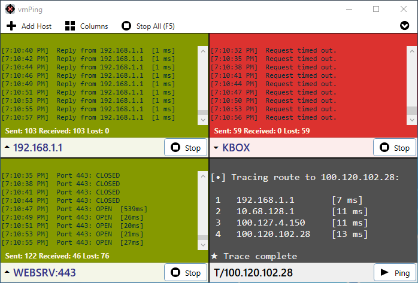
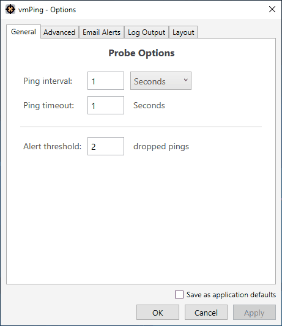
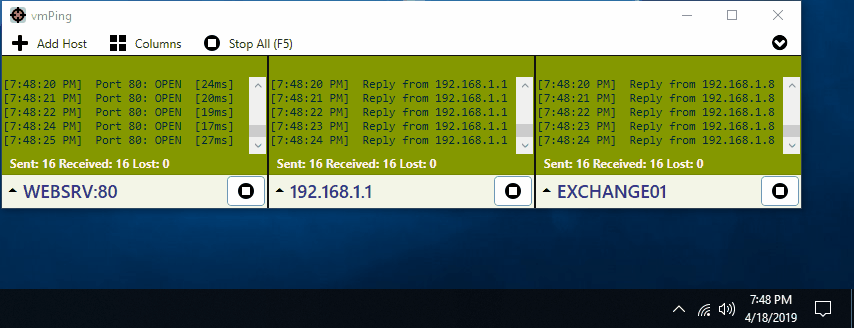

vmPing
======

vmPing (Visual Multi Ping) is a graphical ping utility for monitoring many hosts at once. Each host gets its own color-coded tile that resizes with the window, so you can see the status of every host at a glance.

Along with standard ICMP pings, vmPing can do TCP "port pings", which repeatedly connect to a port and show whether it's open. It also includes DNS lookups, a fast traceroute, alerts for status changes and high latency, and a basic flood tool for stress testing.

**[Download the latest release](https://github.com/R-Smith/vmPing/releases/latest/download/vmPing.exe)**
##### (1.4.4, released November 17, 2026)

##### Notes
* No installer. Just download and run the .exe.
* Requires .NET Framework 4.7.2 or later.

Screenshots
-----------
##### Main Window

##### Options

##### Popup Notification

Recent Changes
--------------
### Version 1.4.1
- Favorites can now be organized into groups.
  - Each group shows as a submenu in the Favorites menu.
  - Choose a group when saving or editing a favorite.
  - In Manage Favorites, drag favorites between groups, or right-click a group to rename or remove it.
- Redesigned the Manage Favorites window.
  - Edit favorites directly in the window, without opening another window.
- 'Create New Favorite Set' is renamed to 'Save as Favorite', and only asks for a name and group.
- The New Alias and Edit Alias windows are combined into one window.
  - Aliases can be removed from the alias window.
- Ping output and status change logs now use one log folder. Status changes are logged to `vmPing-status.txt`. Existing log settings are carried over.
- The log folder is checked for write access when saving options.
- The log folder Browse button now uses the modern Windows folder picker.
- The default ping data now matches Windows ping (32 bytes). This fixes timeouts with devices that don't reply to the previous 33-byte pings (#101).
- Packet size and custom packet data are now saved as separate options. Packet settings from earlier versions are reset to the default.
- The Multi-Input window now supports `# labels`.
- Favorite and group names with underscores now show correctly in the Favorites menu.
- Fixed: Saving options with a packet size other than 33 failed and could corrupt the configuration file.
- The configuration file is now saved safely. If a save fails, the existing file is left unchanged.

### Version 1.4.0
- Choose a probe type by typing `/` in an empty hostname box (Ping, DNS lookup, Traceroute).
- New high latency detection. Access via Options > General.
  - Fixed mode: alert when latency is at or above your set threshold.
  - Dynamic mode: alert when latency goes up by your set threshold from the host's lowest reply time.
- New startup options for window size and position (remember or fixed). Access via Options > Startup.
- New startup option to start minimized. Access via Options > Startup or cli argument `-minimized` or `/minimized`.
- Probe output text can now be selected and copied.
- Aliases now show in place of the hostname.
- Probes show a grip icon and move live while you drag them.
- Favorites can name hosts: `10.0.0.1 # core switch` shows "core switch" in place of the address.
- Comments in favorites (lines starting with `#`) now show as labels instead of probes..
- New option to always show the tray icon.
- Change minimum required .NET framework from 4.5 to 4.7.2.
- Opening the multi-input window automatically selectes all text.
- The default TTL is now 128, to match Windows.
- The `D/` and `T/` hostname prefixes have been replaced by the `/` probe type menu.
- Window titles no longer add " - vmPing".
- The alias color options have been removed.
- Windows now open centered over the main window and stay fully on screen.
- Changing a startup option automatically checks "Save as vmPing defaults".
- Email sending is now async (it won't pause the app while sending).
- 'Input Addresses' is renamed to 'Multi-Input'.
- 'Favorite Sets' is renamed to 'Favorites'.
- TCP probes now use the ping timeout setting.
- Selecting a host from the Aliases menu now uses the correct host and respects the column count.
- Alias lookups are no longer case sensitive.
- Options are all checked before any are saved rather than during save.
- Invalid values in the configuration file are skipped instead of causing errors.
- Don't Fragment is now off by default.
- Ping intervals over 24 hours are rejected.
- Fixed an error when exporting the status history failed.
- Fixed the statistics color for indeterminate status.

### Version 1.3.23
* Fix: Force software rendering. This should fix high GPU usage on some video cards.
* Fix: Loading a favorite on startup was not using the column count for the favorite.
* Fix: Scroll indicator icon would unnecessarily display when the window was resized to small dimensions.
* The position and size of the status history window is now remembered rather than resetting each time it's opened.
* Switch to using SnapToDevicePixels on the main window. Previously, the pixel width for the black borders between probes would sometimes vary when the window was resized. The borders should now always be consistent.
* Removed gaps when hovering mouse between menu buttons (Add Host, Columns, Start/Stop All). Removed gap from right edge of main menu button.
* Some of the menu headers have been renamed on the options screen.

### Version 1.3.21
* If you scroll up in a ping window, automatic scrolling pauses. Automatic scrolling resumes when you scroll back to the bottom. While scrolled up, a small visual indicator appears in the bottom right corner of the ping window.
* Added _always on top_ option. This feature existed in early versions, and now it's back. Found under Options -> Display.
* Added _minimize to tray_ and _exit to tray_ options. Found under Options -> Display. At the moment, the tray icon doesn't do anything to indicate status. It's just a plain icon.
* When logging status changes to a text file, aliases are now included.
* Lots of minor visual changes:
  - On status change alerts, the text for _DOWN_ and _UP_ is now all lowercase _down_ and _up_.
  - On popup alerts, an arrow symbol replaces the word "is". For example _127.0.0.1 is down_ becomes _127.0.0.1 🠖 down_
  - All references to Popup Notifications have been renamed to Popup Alerts (to be consistent with email alerts and audio alerts).
  - Custom styling on the main dropdown menu. Added icons to most menu items.
  - Minor style changes and icons added to the alias and favorites windows.

### Version 1.3.19
* The _Status History_ window now has the ability to export. When exporting, you have three delimiter options: comma (CSV), tab, or space.
* The _Status History_ window has a new, cleaner look with a custom window border.
* Added a _clear_ button to the filter box on the _Status History_ window.
* Auto-scrolling now pauses while clicking (and holding) the scrollbar within each probe window. The ability to completely toggle auto-scrolling is planned.
* Various minor visual style updates.

### Version 1.3.18
* Fix for crashes and performance issues. Issue #70 and Issue #72. Ping output text is no longer selectable. Selectable text was added in version 1.3.15 and this has been causing problems. I will look for another way to reintroduce selectable text in a later version. For now, you can click the icon to open a probe in a separate window and the separate window has selectable text.
* Popup notification window now scales its size to match its contents. Issue #67.
* Add option to enable SSL/TLS for email notifications. Issue #73.

### Version 1.3.17
* Fix: Windows XP/7 would crash when opening the Status History window. This was due to an incompatible reference added in 1.3.16.
* Status History window now has filters. Type in the box to filter by name or address. The different status types are filterable as well: ups, downs, starts, and stops.
* When a system error is encountered while pinging (example: network interface disabled in Windows), vmPing will mark as lost and continue ping attempts. Previously, the pinging would stop entirely.
* Code signed! I purchased a 3-year certificate with your contributions. The pre-compiled binary on this release and all future releases should be code signed. This will get rid of Windows Smart Screen warnings, untrusted publisher errors, and false flagging by antivirus vendors that alert on unsigned executables. You might still see Smart Screen warnings for now since it's reputation-based and this is a brand new cert.

### Version 1.3.16
* Fix: Command line arguments now take precedence over your startup configuration.
* Fix: When changing the title of a favorite, you are now given a warning if the new title already exists.
* The text in each probe window is now selectable. Right-click or CTRL-C to copy. Scrolling is paused while text is selected. Select text from left to right. Selecting text from right to left will not work properly while the probe is active.
* Probe starts and stops are now recorded to the Status History window.
* New Status History window. The data is now displayed as a sortable grid. Filtering and additional options will be included in the next release.
* Keyboard shortcut, F12, opens the Status History window.
* Custom, slimmer, scroll bar style for the probe windows.
* The blinking animation on the stats line when a response is recorded is now much more subtle.
* Stats previously only updated when a response was received or lost. Stats now also update each time a probe is sent.
* Keyboard shortcuts for buttons on the Manage Aliases and Manage Favorites windows.
* Minor style changes to look of the Manage Aliases and Manage Favorites windows.
* Minor style changes to most Windows controls (tab items, drop down boxes, check boxes, radio buttons, text boxes, buttons, etc). Styles should now be more consistent throughout the application.

### Version 1.3.15
* __Startup mode__. You can now configure how vmPing starts. Choose between a blank window (this is the normal, default mode), show the list input window, or load a favorite. For the blank window, you can also set the number of blank probes and initial column count. You will find startup mode settings on the General tab in the Options window. Don't forget to select *Save as vmPing defaults* to make your settings persist.
* When you open the list input window, it now pre-populates with the addresses of the current pings.
* Forced uppercase has been removed from all text boxes.
* Dates and times should now display formatted according to your set region in Windows.

### Version 1.3.14
* __Portable mode.__ Previously, your configuration file had to be stored at %LocalAppData%\vmPing\vmPing.xml. The configuration file includes all favorites, aliases, and default settings for the application. Now vmPing.xml can reside in the same folder as the application, making everything easily portable. Additionally for new users, a simple prompt is displayed if you do anything that would require saving an initial config file. The prompt informs of config file creation, and gives an opportunity to select portable mode if you want your config file created alongside vmPing.exe.
* There's a whole new look to the traceroute window. Check it out. An MTR feature isn't there yet, but should follow in a future release.

Features
--------
* Quickly and easily ping multiple hosts.
* Color coding allows you to instantly determine the status of each host.  Green means up.  Red means down.  Orange means error.
* Each host monitor dynamically resizes and scales with the applications window.
* Options to configure the interval between each ping, the timeout, TTL, and message size.
* Monitor TCP ports.  vmPing will continuously connect to a given TCP port and will display whether the port is open or closed.  Enter _HOSTNAME:PORT_ for the hostname.  Example -  _WebserverA:80_
* Option to log everything to a text file.
* Option to log only status changes to a text file.  A status change is when a host you are pinging goes down, or a down host comes back up.
* Popup notifications to alert you of status changes.
* Email notifications on status changes.
* All colors can be customized.
* Favorites.  Easily save a collections of hosts to be recalled instantly at a later time.
* Aliases.  You can assign a friendly display name for any given host.
* Traceroute.  For the hostname, enter _T/HOSTNAME_ to perform a traceroute.
* DNS forward and reverse lookups.  For the hostname, enter _D/NAME_OR_IP_ to perform a DNS lookup.
* Specify any number of hosts from the command line to instantly begin pinging when the application opens.
* Specify a file containing a list of hosts to load and instantly ping when the application launches.
* Command line usage:
  * vmPing.exe [-i interval] [-w timeout] [`<target_host>`...] [`<file_to_load>`...]

Donations
---------
If this tool has been useful to you, consider donating using PayPal.

